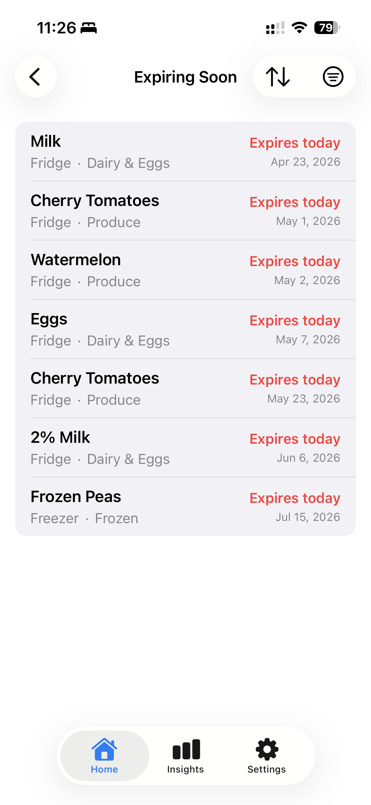
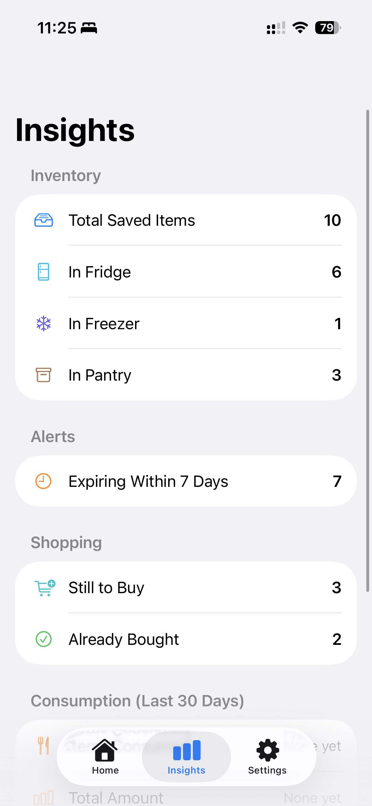
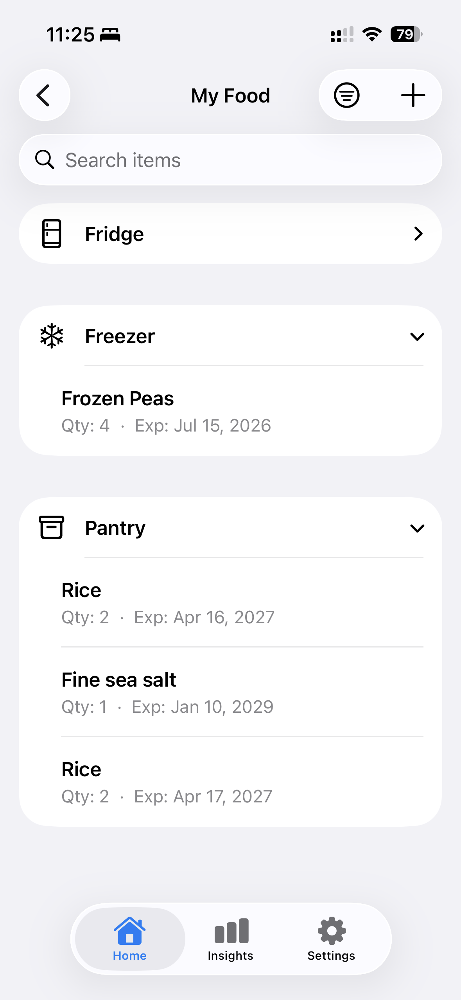
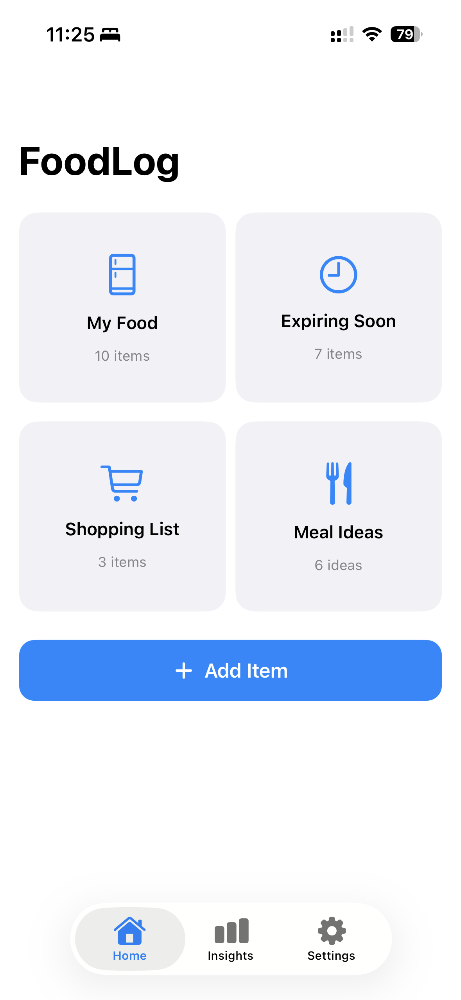
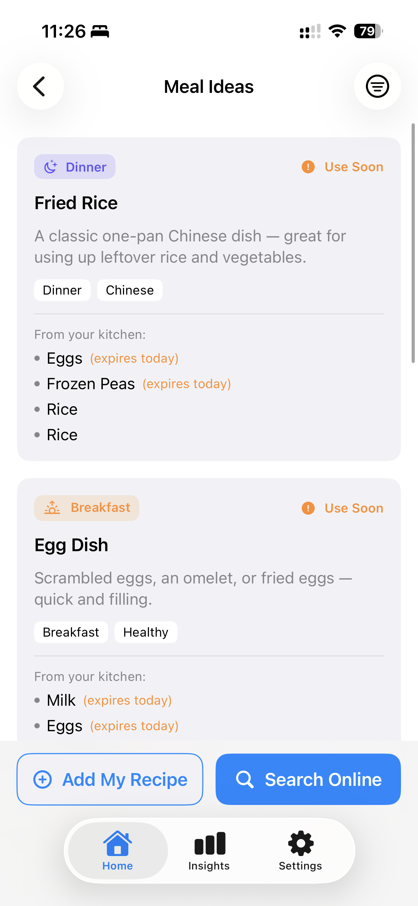

# FridgeLog

**A smarter way to manage your fridge, track groceries, and reduce food waste.**

FridgeLog is an iOS application that simplifies food inventory management by helping users track what they have, when it expires, and what needs to be used.

The app explores how AI-powered inputs can reduce the friction of manually maintaining a household food inventory.

## Features

- **Food inventory management:** Add, edit, and organize food items in one place.
- **Voice-powered entry:** Add multiple food items using natural language, with AI-assisted extraction of structured information.
- **Expiration tracking:** Keep track of food freshness and expiration dates.
- **AI integration:** Explore on-device AI processing and cloud-based language models for more intuitive data entry.

## Demo

*Add screenshots or a short demo GIF here.*

Suggested screenshots:
- Main inventory dashboard
- Voice entry and AI-powered extraction
- Add/edit food item interface

## Tech Stack

- **Language:** Swift
- **UI Framework:** SwiftUI
- **Platform:** iOS
- **Speech Recognition:** Apple Speech Framework
- **AI:** Apple Foundation Models and Claude API (where implemented)
- **Development:** Xcode

## Technical Highlights

### Natural Language to Structured Data

FridgeLog aims to transform conversational inputs into structured food inventory records.

For example:

**Input:** "I bought two cartons of milk, six eggs, and three apples."

**Expected output:**
```json
[
  {"name": "Milk", "quantity": 2, "unit": "cartons"},
  {"name": "Eggs", "quantity": 6, "unit": "pieces"},
  {"name": "Apples", "quantity": 3, "unit": "pieces"}
]
```

This feature explores the integration of speech recognition, natural language processing, and structured data extraction.

## Getting Started

1. Clone the repository.
2. Open `FridgeLog.xcodeproj` in Xcode.
3. Configure the required permissions and API settings.
4. Build and run the application on a compatible device or simulator.

*Device requirements and configuration instructions will be updated as development progresses.*

<p align="center">
  
  
  
  
  
</p>


## Roadmap

- [ ] Improve voice-to-structured-data accuracy
- [ ] Expand image-based food recognition
- [ ] Add expiration reminders
- [ ] Improve inventory management workflows

## Project Status

FridgeLog is an actively developed personal project. Features and implementation details may change.

## License

Copyright © 2026. All rights reserved unless otherwise specified.
